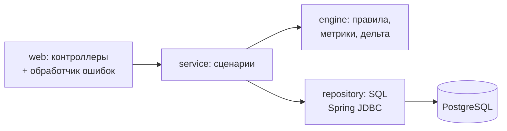

# Модуль ККД: контроль качества данных по целям (backend)

Сервис на Java 17 / Spring Boot 3: раз в неделю проверяет цели и ключевые результаты (КР) по четырём правилам,
сохраняет результаты прогона в PostgreSQL и отдаёт странице ККД метрики, найденные проблемы и дельту
с прошлым прогоном. Тестовое задание «Backend-разработчик (Java)».

**Решение написано с ИИ-ассистентом** по спецификации: [`specs/requirements.md`](specs/requirements.md)
(что делает и критерии приёмки) и [`specs/design.md`](specs/design.md) (модель данных, API, ключевые решения).

Стек: Java 17, Spring Boot 3.5 (Web, JDBC, Validation), PostgreSQL 16, Liquibase, Maven, JUnit 5.

## Запуск

```bash
docker compose up --build
```

Поднимутся PostgreSQL 16 и сервис на `http://localhost:8080`. При старте сервис сам накатит миграции и демо-данные
(Liquibase) и выполнит прогон RUN-003 по текущим данным. Настройки — переменные окружения, список с пояснениями —
[`.env.example`](.env.example) (скопировать в `.env`, если нужно поменять).

```bash
curl "http://localhost:8080/api/runs"
curl "http://localhost:8080/api/kkd/summary"                          # latest, корень оргструктуры
curl "http://localhost:8080/api/kkd/summary?run_id=RUN-003&unit_id=HQ-CIB"
curl "http://localhost:8080/api/kkd/issues?unit_id=CIB-REG&severity=minor,major&limit=10"
curl -X POST "http://localhost:8080/api/runs"                         # внеплановый прогон
curl "http://localhost:8080/api/kkd/summary?run_id=RUN-002"           # 409 RUN_FAILED
```

Без Docker, против своей PostgreSQL 15+: `DB_URL=jdbc:postgresql://localhost:5432/goal_tracker DB_USERNAME=... DB_PASSWORD=... KKD_TODAY=2026-10-26 ./mvnw spring-boot:run`.

## Тесты

Нужен только JDK 17+ — ни Docker, ни установленный PostgreSQL не нужны:

```bash
./mvnw test          # Windows: mvnw.cmd test
```

Интеграционные тесты поднимают встроенный PostgreSQL 16 ([zonky embedded-postgres](https://github.com/zonkyio/embedded-postgres)),
накатывают те же миграции, что и приложение, и ходят в API через MockMvc. Всего 42 теста:

| Тест | Что проверяет |
|---|---|
| `KrWeightsSumRuleTest` | веса 99 / 100 / 101; цель с пустым списком КР; неактивная цель |
| `KrStaleProgressRuleTest` | 45 дней — норма, 46 — проблема; КР закрытой цели |
| `GoalNoKrRuleTest`, `CascadeNoParentRuleTest` | пустой список КР; цель блока без родителя — норма; «висячий» родитель |
| `MetricsCalculatorTest` | метрика департамента с дочерними управлениями; пустое подразделение → `null`; рекурсия по дереву |
| `DeltaCalculatorTest` | первый прогон → `null`; new / persisting / resolved; `trend` с учётом `higher_is_better` |
| `LiquibaseRollbackTest` | накат → откат до пустой схемы → повторный накат |
| `KkdApiTest` | `/api/runs`, `/api/kkd/summary`, `/api/kkd/issues` на демо-данных; 404 / 409 / 422; согласованность сидов |
| `RunExecutionTest` | `POST /api/runs`: новый прогон сравнивается с предыдущим |

## Миграции: накат → откат → повторный накат

Миграции — `src/main/resources/db/changelog/`: главный файл `db.changelog-master.yaml` и SQL-файлы `changes/`.
У каждого changeset, включая стартовые данные, есть `--rollback`. Первый changeset ставит тег `baseline`
(пустая схема) — до него и откатываем.

**Автотест** — `LiquibaseRollbackTest`: `./mvnw test -Dtest=LiquibaseRollbackTest`.

**Руками против поднятой БД** (по умолчанию плагин ходит в `localhost:5432/goal_tracker`, логин и пароль `goal_tracker`, как в docker-compose;
другое — через `-Ddb.url=... -Ddb.username=... -Ddb.password=...`):

```bash
docker compose up -d db
./mvnw liquibase:update                                     # накат (или просто запустить сервис)
./mvnw liquibase:rollback -Dliquibase.rollbackTag=baseline  # откат всего, таблиц не остаётся
./mvnw liquibase:update                                     # повторный накат
./mvnw liquibase:status                                     # «is up to date»
```

Откат работает и после того, как сервис уже сделал свои прогоны: откат демо-прогонов удаляет все прогоны
(они построены на демо-данных и ссылаются на RUN-001).

Почему Liquibase, а не Flyway: откат во Flyway (`undo`) есть только в платной редакции, а откат — условие приёмки.
В Liquibase откат пишется рядом с каждым изменением и бесплатен.

## Архитектура



- **Где живут правила.** `engine/rules/` — по классу на правило, общий интерфейс `Rule`. `RuleEngine` получает
  снимок данных (оргструктура, цели, КР на дату) и возвращает список проблем. Пакет `engine` не знает ни про Spring,
  ни про БД, ни про HTTP — поэтому тестируется обычным JUnit за доли секунды.
- **Как считаются метрики.** Во время прогона `MetricsCalculator` считает три метрики для **каждого** подразделения
  вместе со всеми дочерними (`UnitTree.descendantsOrSelf` — рекурсивный обход дерева) и пишет их в `kkd_run_metric`.
  Сводка потом берёт готовые числа текущего и прошлого прогона — старый снимок данных пересобирать не нужно.
- **Как считается дельта.** У каждой проблемы есть отпечаток `ПРАВИЛО:объект`. Новый прогон при запуске запоминает,
  с каким сравнивается — с последним **успешным** (упавший пропускается). `DeltaCalculator` сравнивает множества
  отпечатков: есть сейчас и не было — `new`, есть в обоих — `persisting`, было и исчезло — `resolved`.
  Первый прогон: сравнивать не с чем — `null`, а не 0.
- **Ошибки** — `ApiExceptionHandler` (`@RestControllerAdvice`): единый формат `{"error": {"code", "message"}}`,
  404 `RUN_NOT_FOUND` / `UNIT_NOT_FOUND`, 409 `RUN_FAILED` / `RUN_IN_PROGRESS`, 422 `INVALID_PARAM`.

Почему Spring JDBC, а не JPA: таблиц мало, запросы — выборки и агрегаты; в коде виден ровно тот SQL, который выполняется.
Подробнее — [`specs/design.md`](specs/design.md).

## Стартовые данные

Оргструктура: **Корпоративный блок** `B2B` → **Департамент корпоративного бизнеса** `HQ-CIB` → управления
`CIB-KEY` и `CIB-REG` (+ `CIB-TRADE` без целей — на нём видно `null` в метриках). 26 целей (23 активные), 40 КР.
Неактивные цели с «нарушениями» (черновик без КР, закрытая со старым фактом, отменённая без КР) правила не трогают.

| Прогон | Дата снимка | Статус | Откуда | Проблем |
|---|---|---|---|---|
| RUN-001 | 2026-10-12 | completed | исторический результат, лежит в сидах как есть | 12 |
| RUN-002 | 2026-10-19 | failed | в сидах: «таймаут выгрузки», результатов нет → 409 | — |
| RUN-003 | 2026-10-26 | completed | **движок при старте** по текущим данным, сравнение с RUN-001 | 13 |

Почему так: в таблицах целей хранится только текущее состояние, а прошлая неделя была другой. Поэтому результат
прошлой недели лежит в БД готовым (как лежал бы после настоящего прогона), а текущий честно считает движок.
Набор целей между прогонами не менялся, поэтому метрики RUN-001 перепроверяются движком в тесте `seedConsistency`.

Что изменилось в данных между RUN-001 и RUN-003:

| Дельта | Проблемы |
|---|---|
| **new — 5** | `GOAL_NO_KR` G-022 (удалили КР), `KR_WEIGHTS_SUM` G-017 (60+50), `CASCADE_NO_PARENT` G-020 (отвязали), `KR_STALE_PROGRESS` KR-025 (ровно 46 дней) и KR-031 (55 дней) — перешагнули порог |
| **persisting — 8** | `GOAL_NO_KR` G-013, `KR_WEIGHTS_SUM` G-004 (99%) и G-008 (90%), `CASCADE_NO_PARENT` G-011 и G-016, `KR_STALE_PROGRESS` KR-018, KR-034, KR-039 |
| **resolved — 4** | `GOAL_NO_KR` G-009 (добавили КР), `KR_WEIGHTS_SUM` G-007 (стало 50+50), `CASCADE_NO_PARENT` G-023 (привязали), `KR_STALE_PROGRESS` KR-030 (обновили факт) |

KR-026 обновлялся ровно 45 дней назад — граница, не нарушение.

Метрики RUN-003 (в скобках — RUN-001), подразделение вместе с дочерними:

| Подразделение | Доля корректных целей, % | Покрытие каскадом, % | Найдено проблем |
|---|---|---|---|
| B2B (всё) | 43.5 (47.8) — worse | 86.4 (86.4) — same | 13 (12) — worse |
| HQ-CIB | 40.9 (45.5) — worse | 86.4 (86.4) — same | 13 (12) — worse |
| CIB-KEY | 44.4 (22.2) — better | 88.9 (88.9) — same | 5 (7) — better |
| CIB-REG | 30.0 (60.0) — worse | 80.0 (80.0) — same | 7 (4) — worse |
| CIB-TRADE | null (null) | null (null) | null (null) |

## Что проверено

- `./mvnw test` — 42 теста зелёные (юнит + встроенный PostgreSQL 16).
- Собранный jar запускался против PostgreSQL 16: миграции, стартовый прогон RUN-003 и ответы API совпали с таблицами выше;
  команды `liquibase:status` → `rollback` до `baseline` → `update` → `status` из раздела «Миграции» прошли.
- `docker compose up` на машине разработки не запускался: там нет Docker. `Dockerfile` и `docker-compose.yml` написаны
  по стандартной схеме (сборка Maven → образ `eclipse-temurin:17-jre`, `postgres:16` с healthcheck).

## Как объяснить на собеседовании

**Простыми словами.** Сотрудники заводят цели и ключевые результаты, и часто — с ошибками: КР нет, веса не сходятся
в 100%, цель ни к чему не привязана, факт полгода не обновляли. Сервис раз в неделю делает «прогон»: берёт все данные,
прогоняет через четыре правила и записывает найденные проблемы. Это та же работа тестировщика, только проверяем
данные: правило, ожидаемое значение, фактическое, отчёт. Потом сравниваем с прошлой неделей: что появилось, что осталось,
что исправили, и считаем три метрики для каждого подразделения вместе с дочерними. Фронтенд получает всё готовым.

**Как устроен код — как кафе.** Контроллер — официант: принял заказ (параметры запроса), проверил, что он вообще
читаемый, отнёс на кухню. Сервис — повар: знает рецепт (найти прогон, взять метрики, посчитать дельту).
Репозиторий — кладовщик: достаёт продукты из склада (SQL к PostgreSQL). Движок правил — отдельный
кондитерский цех: ему приносят продукты, он выдаёт результат и не знает, кто заказал и где склад.

**Вероятные вопросы:**

1. *Почему движок правил отдельно от API и БД?* Чтобы правило можно было проверить тестом без базы и сервера: дал на вход
   три цели — получил список проблем. И чтобы добавить правило, не трогая контроллеры: новый класс + строка в справочнике.
2. *Что такое Liquibase и зачем откат?* Это «git для схемы базы»: каждое изменение — пронумерованный шаг, Liquibase
   помнит, какие уже применены. У каждого шага записано, как его отменить. Если релиз пошёл не так, базу откатывают
   на нужный шаг, а не чинят руками. В задании это условие приёмки: накат → откат → накат без ошибок.
3. *Почему не Flyway?* Откат во Flyway только в платной версии. В Liquibase он бесплатный и пишется прямо рядом с изменением.
4. *Как понять, что проблема «та же самая»?* У проблемы есть отпечаток: код правила + id объекта, например
   `KR_WEIGHTS_SUM:G-004`. Совпал отпечаток в двух прогонах — persisting; есть только сейчас — new; был и пропал — resolved.
   Из отпечатка же делается id проблемы для фронта — он одинаковый во всех прогонах.
5. *Почему null, а не 0?* Ноль — это «посчитали, получилось ноль»: 0% корректных целей значит «всё плохо». Null — «не из
   чего считать»: у первого прогона нет прошлого, у подразделения нет целей. Подставить 0 — соврать пользователю.
6. *Как метрики учитывают каскад?* Оргструктура — дерево. Для подразделения рекурсивно собираем его и всех потомков
   на любой глубине и считаем метрику по их целям. Поэтому у департамента 13 проблем — это сумма его и двух управлений.
7. *Почему метрики прогона хранятся, а не считаются на лету?* Данные целей меняются, а снимка прошлой недели нет.
   Если хранить готовые числа по каждому подразделению, сравнение с прошлым прогоном — просто чтение двух строк.
8. *Что будет, если прогон упал?* Он остаётся в истории со статусом `failed` и текстом ошибки, его результаты
   отдают 409. Следующий прогон сравнивается с последним успешным, упавший пропускается.
9. *Чем 404 отличается от 422?* 422 — запрос кривой: `limit=0`, `severity=urgent`, `run_id=abc`. 404 — запрос
   правильный, но такого нет: `RUN-999`. 409 — объект есть, но в неподходящем состоянии: прогон упал.
10. *Почему `trend` отдельно от `delta`?* Минус не всегда плохо: «найдено проблем» −2 — это лучше, а «доля
    корректных» −2 — хуже. Поэтому у метрики есть `higher_is_better`, и сервер сам говорит better / worse / same.

**Про ИИ честно:** решение сделано с ИИ-ассистентом по спецификации из `specs/`; я её читал, проверил цифры
на демо-данных и могу объяснить каждое решение.

## Мотивация

**Почему интересен проект.** Учусь в Школе 21 на направлении QA. Контроль качества данных — та же работа тестировщика,
только проверяем не код, а данные: правило, ожидаемое значение, фактическое, отчёт, повторная проверка. Интересно пройти
путь от бизнес-требований до работающего модуля в реальной команде и увидеть, как правила проверки превращаются
в метрики, по которым руководители принимают решения.

**Роль в команде.** Бэкенд-разработчик, который пишет логику правил, API и миграции и сразу думает как тестировщик:
где граничные случаи (45 или 46 дней, 99 или 100%), какие критерии приёмки, как проверить результат автотестом.

**Время.** 20 часов в неделю, на весь срок стажировки.
