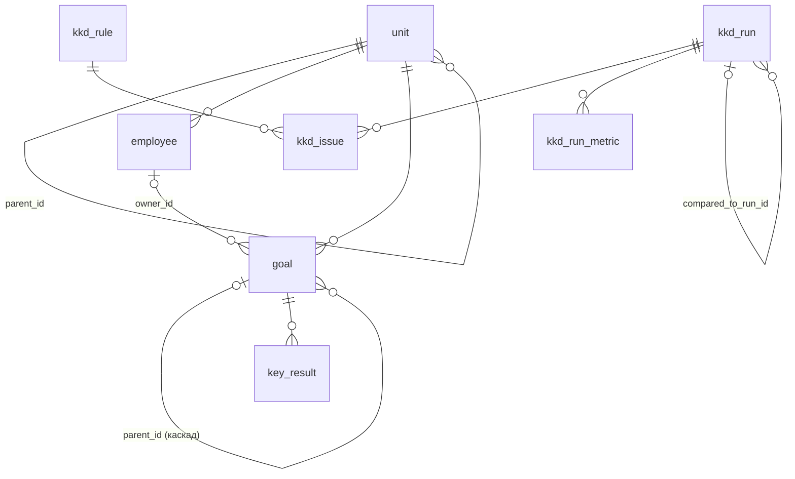

# Дизайн: сервис модуля ККД (backend)

## Слои

```
web (контроллеры, обработчик ошибок)   — принять параметры, отдать JSON
  └─ service (RunService, SummaryService, IssueQueryService, UnitScopeService, StartupRunInitializer)
       ├─ engine  (правила, метрики, дельта)  — чистая Java, без Spring / БД / HTTP
       └─ repository (Spring JDBC)            — SQL к PostgreSQL
dto — формы ответов API
```

Пакет `ru.goaltracker.kkd`:

| Пакет | Что внутри |
|---|---|
| `engine` | `Rule` (интерфейс), `RuleEngine`, `RuleContext`, `Issue`, `UnitTree`, `MetricsCalculator`, `MetricComparison`, `Trend`, `DeltaCalculator` |
| `engine.rules` | по классу на правило + `StandardRules` (включённый набор) |
| `repository` | `UnitRepository`, `GoalDataRepository`, `RunRepository`, `IssueRepository`, `RunMetricRepository`, `RuleRepository` |
| `service` | сценарии + `KkdException` / `ErrorCode` |
| `web` | `RunController`, `KkdController`, `ApiExceptionHandler` |
| `config` | `KkdProperties` (переменные `KKD_*`), `EngineConfig` (бин движка) |

## Модель данных



| Таблица | Ключевые поля |
|---|---|
| `unit` | `id`, `name`, `level` (block / hq / unit), `parent_id` → unit |
| `employee` | `id`, `full_name`, `position`, `unit_id` |
| `goal` | `id`, `title`, `unit_id`, `owner_id` (null — нет ответственного), `parent_id` → goal, `level` (block / hq / unit / employee), `status` (draft / active / closed / cancelled), `deadline` |
| `key_result` | `id`, `goal_id`, `title`, `metric_unit`, `target_value`, `fact_value`, `weight` (целое 0–100), `fact_updated_at` |
| `kkd_rule` | `code`, `title`, `severity`, `object_type`, `description`, `recommendation` |
| `kkd_run` | `id` (RUN-001), `number`, `status` (running / completed / failed), `trigger_type` (schedule / manual / startup), `snapshot_date`, `compared_to_run_id`, `started_at`, `finished_at`, `error` |
| `kkd_issue` | `run_id`, `fingerprint` (уникален в прогоне), `rule_code`, `severity`, `object_type`, `object_id`, `goal_id`, `kr_id`, `unit_id`, `details`, `actual_value`, `expected_value` |
| `kkd_run_metric` | `run_id`, `unit_id`, `metric_key`, `value` (null — нет активных целей) |

У `kkd_issue` и `kkd_run_metric` нет внешних ключей на цели и подразделения: это снимок на момент прогона,
история не должна ломаться, если цель потом удалят или переименуют.

## API

Все ответы — JSON, поля в `snake_case`. Ошибки — `{"error": {"code": "...", "message": "..."}}`.

### GET /api/runs?limit=20&offset=0

`limit` 1–100. Ответ: `{"items": [...], "total", "limit", "offset"}`, прогоны от новых к старым:

```json
{"id": "RUN-003", "number": 3, "status": "completed", "trigger": "startup",
 "snapshot_date": "2026-10-26", "started_at": "...", "finished_at": "...",
 "compared_to_run_id": "RUN-001", "issues_total": 13, "error": null}
```

### POST /api/runs

Выполняет прогон синхронно, `201` + прогон в том же виде. Если другой прогон в статусе `running` — `409 RUN_IN_PROGRESS`.

### GET /api/kkd/summary?run_id=latest&unit_id=

```json
{
  "run": {"id": "RUN-003", "snapshot_date": "2026-10-26"},
  "compared_to": {"id": "RUN-001", "snapshot_date": "2026-10-12"},
  "unit": {"id": "B2B", "name": "Корпоративный блок", "level": "block", "parent_id": null},
  "metrics": [
    {"key": "clean_goals_share", "title": "Доля корректных целей", "unit": "%", "higher_is_better": true,
     "value": 43.5, "previous": 47.8, "delta": -4.3, "trend": "worse"}
  ],
  "issues_by_severity": [{"code": "critical", "title": "Критичная", "current": 2, "previous": 2, "delta": 0}],
  "delta": {"new": 5, "persisting": 8, "resolved": 4}
}
```

### GET /api/kkd/issues?run_id=&unit_id=&rule_code=&severity=&limit=20&offset=0

`rule_code` и `severity` — через запятую. Ответ: `{"run_id", "items", "total", "limit", "offset"}`, элемент:

```json
{"id": "ISS-…", "fingerprint": "KR_STALE_PROGRESS:KR-025", "rule_code": "KR_STALE_PROGRESS",
 "rule_title": "…", "severity": "minor", "object_type": "key_result", "object_id": "KR-025",
 "goal_id": "G-015", "goal_title": "…", "kr_id": "KR-025", "kr_title": "…",
 "unit_id": "CIB-REG", "unit_name": "…", "details": "Факт обновлялся 46 дн. назад (2026-09-10)",
 "actual": "46", "expected": "<= 45", "delta_status": "new"}
```

Порядок: critical → major → minor, затем подразделение, объект, правило.

### Ошибки

| Код | HTTP | Когда |
|---|---|---|
| `RUN_NOT_FOUND` | 404 | прогона нет; или `latest`, а успешных прогонов нет |
| `UNIT_NOT_FOUND` | 404 | подразделения нет |
| `NOT_FOUND` | 404 | неизвестный адрес |
| `RUN_FAILED` | 409 | прогон упал — результатов нет |
| `RUN_IN_PROGRESS` | 409 | прогон ещё выполняется |
| `INVALID_PARAM` | 422 | `run_id` не `latest` и не `RUN-NNN`; `unit_id` с недопустимыми символами; `limit` / `offset` вне диапазона или не число; неизвестные `severity` / `rule_code` |

Порядок проверок: формат фильтров (422) → подразделение (422 / 404) → прогон (422 / 404 / 409).

## Как считается

**Прогон** (`RunService.execute`): создать запись `running` с `compared_to_run_id` = последний успешный прогон →
прочитать снимок (оргструктура, все цели, все КР) → `RuleEngine.check` → `MetricsCalculator.calculateForAllUnits`
(метрики для **каждого** подразделения вместе с дочерними) → в одной транзакции записать проблемы, метрики и статус
`completed`. Исключение по дороге — статус `failed` и текст ошибки, прогон остаётся в истории.

**Каскад в метриках**: `UnitTree.descendantsOrSelf` рекурсивно собирает подразделение и всех потомков,
метрика считается по активным целям этого множества.

**Сводка**: метрики текущего и прошлого прогона читаются готовыми из `kkd_run_metric`, `MetricComparison`
даёт дельту и `trend`. Разбивка по важности и new / persisting / resolved — из проблем двух прогонов,
отфильтрованных по подразделению с дочерними (`DeltaCalculator`).

**Статус проблемы в списке** (`delta_status`): есть ли её отпечаток в прогоне сравнения.

**id проблемы**: `ISS-` + первые 10 hex-символов SHA-256 от отпечатка, верхний регистр — одинаков во всех прогонах.

## Ключевые решения

1. **Spring JDBC, а не JPA.** Таблиц мало, запросы — выборки и агрегаты; видно ровно тот SQL, который выполняется, без ленивой загрузки и прокси.
2. **Liquibase, а не Flyway.** Откат (`undo`) во Flyway — только в платной редакции, а откат — условие приёмки. В Liquibase rollback пишется рядом с каждым changeset и бесплатен. Changeset-ы в формате SQL — их читает любой, кто знает SQL.
3. **Тег `baseline`** первым changeset-ом: «откатить всё» = `rollback` до этого тега.
4. **Демо-данные — контекст `demo`.** `LIQUIBASE_CONTEXTS=prod` накатит только схему и справочник правил.
5. **Откат демо-прогонов удаляет все прогоны**: прогоны, которые приложение сделало позже, ссылаются на RUN-001 и построены на демо-данных.
6. **Метрики прогона хранятся по каждому подразделению.** Для дельты не нужен старый снимок данных — данные с тех пор менялись.
7. **`compared_to_run_id` фиксируется при запуске** — список прогонов честно показывает, с чем сравнивали; упавшие пропускаются.
8. **null, а не 0**: нет прошлого прогона → `previous`, `delta`, `trend` и счётчики дельты `null`; нет активных целей → все метрики `null`. 0 — это «посчитали, получилось ноль», null — «считать было не из чего».
9. **Одна причина — одна проблема**: цель без КР даёт `GOAL_NO_KR`, но не `KR_WEIGHTS_SUM`.
10. **Дата снимка настраивается** (`KKD_TODAY`): в демо 2026-10-26, чтобы цифры не зависели от дня запуска. Пусто — текущая дата.
11. **Стартовый прогон**: при старте, если за дату снимка успешного прогона нет, приложение само выполняет прогон (так появляется RUN-003). Повторный старт ничего не дублирует.

## Стартовые данные

Оргструктура: `B2B` (блок) → `HQ-CIB` (департамент) → `CIB-KEY`, `CIB-REG`, `CIB-TRADE` (в нём целей нет).
26 целей, 23 активные, 40 КР. Прогоны:

| Прогон | Дата | Статус | Как появился | Проблем |
|---|---|---|---|---|
| RUN-001 | 2026-10-12 | completed | исторический результат в сидах | 12 |
| RUN-002 | 2026-10-19 | failed | в сидах, «таймаут выгрузки» | — |
| RUN-003 | 2026-10-26 | completed | движок при старте, сравнение с RUN-001 | 13 |

Между RUN-001 и RUN-003: new 5, persisting 8, resolved 4 (подробно — README и комментарий в `005-demo-runs.sql`).
Набор целей и их статусы между прогонами не менялись, поэтому метрики RUN-001 перепроверяются движком (`KkdApiTest.seedConsistency`).

## Расширение

Новое правило = класс, реализующий `Rule`, + строка в `StandardRules.all()` + changeset со строкой в `kkd_rule`.
Тест `seedConsistency` упадёт, если код или важность в классе и в справочнике разойдутся.
